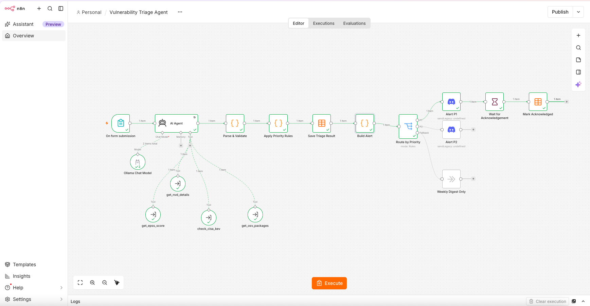
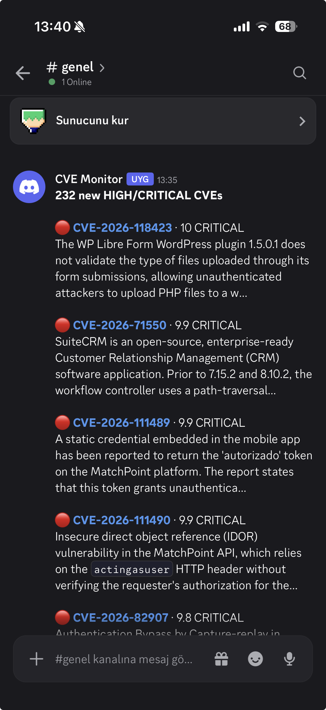

# n8n Automation Portfolio

Self-hosted [n8n](https://n8n.io) workflows running on Docker. Each workflow is versioned as JSON in this repository and can be imported into a fresh n8n instance in a few commands.

## Projects

### [Vulnerability Triage Agent](docs/vulnerability-triage-agent.md)

An AI agent that decides how urgently a CVE must be fixed. It gathers evidence with four tools (NVD, EPSS, CISA KEV and OSV.dev), explains its reasoning in plain language and names the package versions that fix the issue. The priority is double-checked by deterministic rules, results are stored in a table, and critical findings wait for human acknowledgement. Runs entirely on a local LLM.



**n8n features:** AI Agent with tool calling · sub-workflows as tools · Ollama Chat Model · Data Tables · Switch routing · Wait node (human-in-the-loop) · Form Trigger · Error Trigger

### [CVE Monitor](docs/cve-monitor.md)

Checks the NVD every hour for newly published HIGH and CRITICAL vulnerabilities and posts a compact summary to Discord.



**n8n features:** Schedule Trigger · HTTP Request with credentials · Code node · deduplication across executions · Discord webhook

## Getting started

**Requirements:** Docker with Docker Compose, a free [NVD API key](https://nvd.nist.gov/developers/request-an-api-key) and a Discord channel webhook. Some projects need more, see their pages.

```bash
git clone https://github.com/aydin-omer/n8n-portfolio.git
cd n8n-portfolio
cp .env.example .env          # then set N8N_ENCRYPTION_KEY (openssl rand -hex 32)
docker compose up -d
./scripts/import-workflows.sh
```

Then open http://localhost:5679, create the owner account and add the credentials shared by all projects:

| Credential name | Type | Value |
|---|---|---|
| `NVD API Key` | Header Auth | Name `apiKey`, value: your NVD key |
| `Discord CVE Alerts` | Discord Webhook API | Your Discord webhook URL |

Each project page explains the remaining steps. The **Error Handler** workflow is already attached to the projects and posts failures of automatic runs to the same Discord channel.

## Repository structure

```
├── docker-compose.yml        # n8n service, pinned version, bound to localhost
├── .env.example              # required environment variables
├── scripts/
│   ├── export-workflows.sh   # n8n → ./workflows (strips test data, scans for secrets)
│   └── import-workflows.sh   # ./workflows → n8n
├── workflows/                # one JSON file per workflow, named by workflow ID
└── docs/                     # one page per project, screenshots in docs/images/
```

## Roadmap

- Weekly digest of triage results, including P1 findings that were never acknowledged
- Automatic daily intake for the triage agent, with acknowledgement moved to a webhook workflow so that one waiting P1 cannot block a batch
