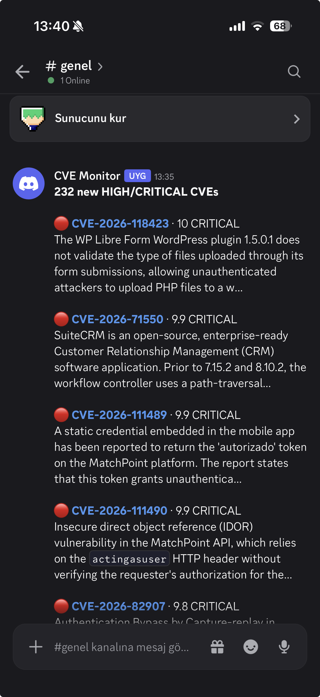
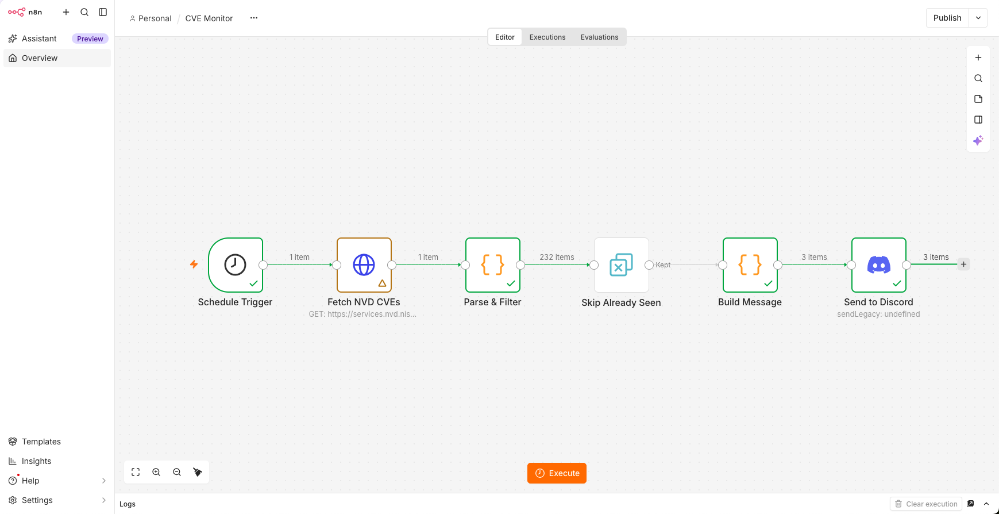
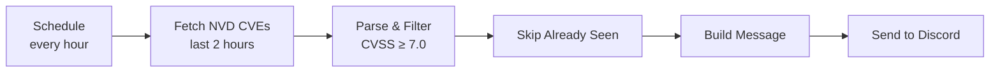

# CVE Monitor

Checks the [NVD](https://nvd.nist.gov) every hour for newly published HIGH and CRITICAL vulnerabilities and posts a compact summary to a Discord channel.

## How it works

1. **Fetch NVD CVEs** queries the NVD CVE API 2.0 for everything published in the last two hours.
2. **Parse & Filter** flattens the API response, picks the newest CVSS version available (4.0, then 3.1, then 3.0) and keeps only CVEs scoring 7.0 or higher. Rejected entries and CVEs without a score are dropped.
3. **Skip Already Seen** remembers CVE IDs across executions, so no CVE is reported twice.
4. **Build Message** sorts CVEs by score and packs them into as few Discord messages as possible.
5. **Send to Discord** posts the messages through a webhook.

## Design decisions

- **Overlapping time window.** The workflow runs every hour but looks back two hours. A delayed run or a brief NVD outage never causes a CVE to be missed. The resulting duplicates are removed by the deduplication step.
- **No secrets in the repository.** The NVD API key and the Discord webhook URL live in n8n's encrypted credential store. The exported workflow JSON only references credentials by name.
- **Flood protection.** Discord rate-limits fast bursts of messages, and dozens of notifications are easy to ignore. CVEs are packed into messages under Discord's 2,000-character limit, and a single run sends at most three messages. Anything beyond that is summarised with a link to the full NVD search.
- **Silent when there is nothing to report.** If no new CVE matches the filter, no message is sent.

## Known limitations

- NVD often publishes new CVEs before scoring them. Such CVEs are skipped by the filter, so a CVE may never be reported if it receives its score after leaving the two-hour window.
- Only CVSS base scores are considered. Exploitability signals such as CISA KEV and EPSS are used by the [Vulnerability Triage Agent](vulnerability-triage-agent.md) instead.

## Configuration

| Setting | Where | Default |
|---|---|---|
| Minimum CVSS score | `MIN_SCORE` in **Parse & Filter** | `7.0` |
| Messages per run | `MAX_MESSAGES` in **Build Message** | `3` |
| Schedule | **Schedule Trigger** | Every hour at minute 5 |

## Setup

Complete the [shared setup](../README.md#getting-started) first. Then open the **CVE Monitor** workflow, select the `NVD API Key` and `Discord CVE Alerts` credentials in the **Fetch NVD CVEs** and **Send to Discord** nodes, and publish the workflow.
