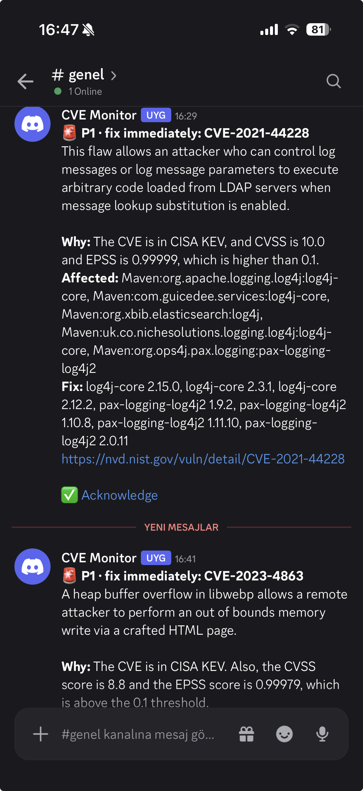
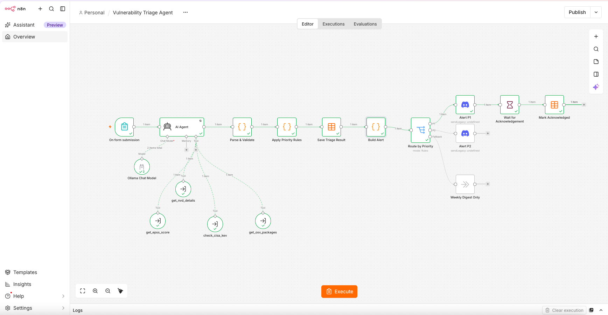
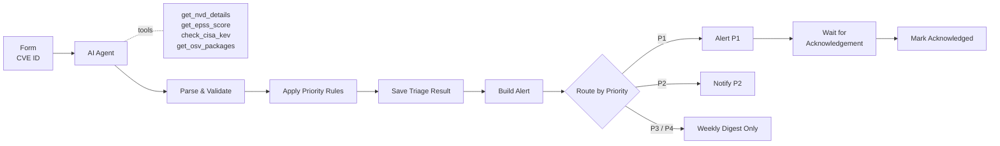
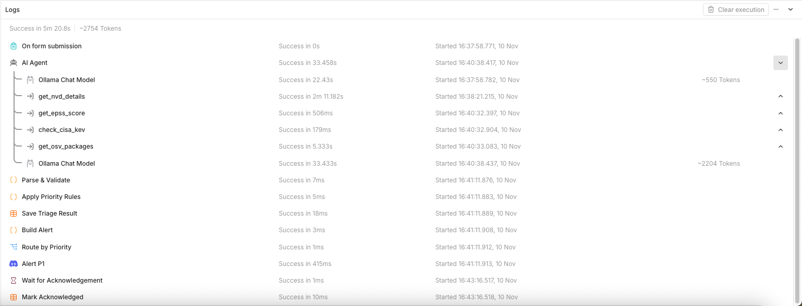
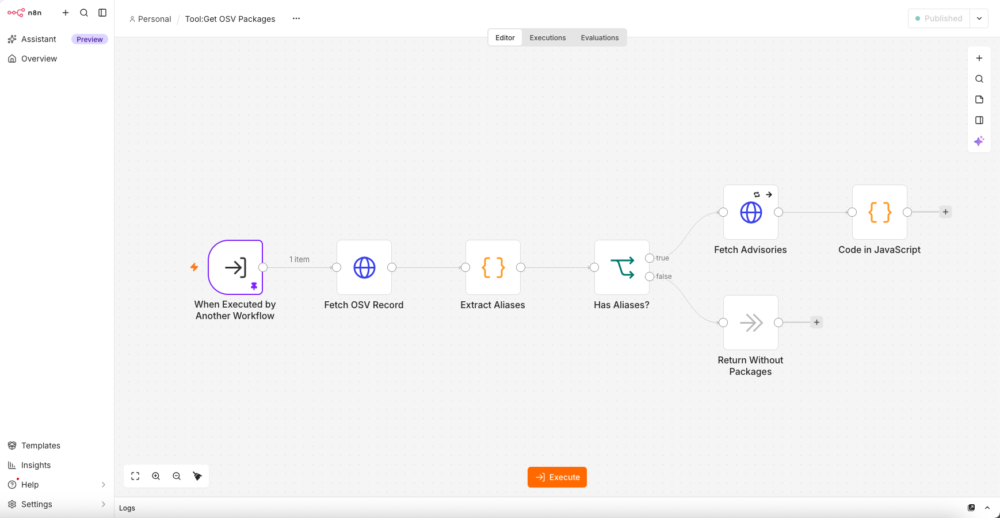
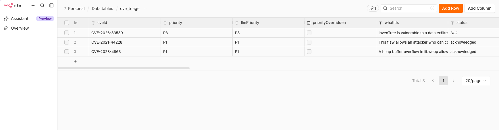
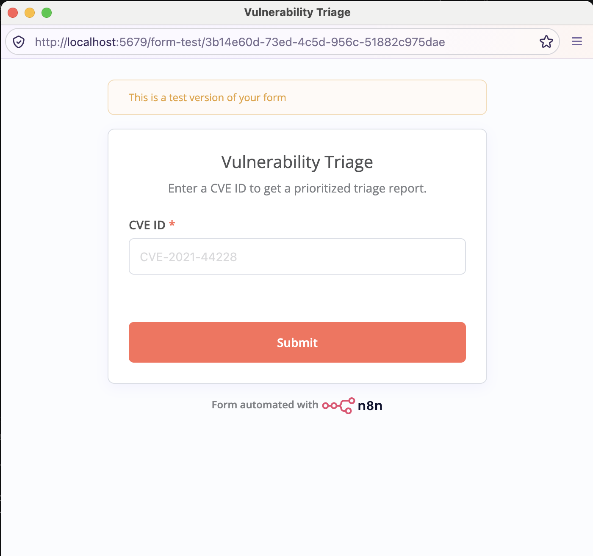

# Vulnerability Triage Agent

An AI agent that decides how urgently a CVE must be fixed and explains why. It gathers evidence from four public sources, writes a plain-language assessment and names the package versions that fix the issue. A deterministic rule check confirms the priority, every result is stored in a table, and critical findings wait for a human to acknowledge them.

Everything runs locally: n8n in Docker and the language model in [Ollama](https://ollama.com). No data leaves the machine except the public API lookups.



## Why

A CVSS score says how bad a vulnerability could be, not how likely it is to hurt you. Most high-scoring CVEs are never exploited, while some medium ones are exploited within days. A useful triage combines several signals:

| Signal | Question it answers | Source |
|---|---|---|
| CVSS, CWE, affected products | How severe is it and what does it affect? | [NVD](https://nvd.nist.gov) |
| EPSS | How likely is exploitation in the next 30 days? | [FIRST.org](https://www.first.org/epss/) |
| KEV | Has exploitation in the wild been confirmed? | [CISA](https://www.cisa.gov/known-exploited-vulnerabilities-catalog) |
| Affected packages, fixed versions | What exactly do I need to upgrade? | [OSV.dev](https://osv.dev) |

## How it works





1. **Form** accepts a CVE ID.
2. **AI Agent** runs `mistral-small:24b` in Ollama. Its system prompt requires it to call all four tools, use only the data they return, apply the priority rules and answer in a fixed JSON format.
3. **Parse & Validate** extracts and checks the JSON. Structural problems stop the run with a clear error. Small type slips, such as a single string where a list was expected, are repaired.
4. **Apply Priority Rules** recomputes the priority in code from the raw tool results. If the model disagrees, the rules win and the disagreement is recorded.
5. **Save Triage Result** upserts the result into the `cve_triage` data table, so a CVE triaged twice keeps a single, current row.
6. **Build Alert** and **Route by Priority** send P1 and P2 findings to Discord. P3 and P4 stay in the table.
7. For P1 findings, **Wait for Acknowledgement** pauses the execution until someone clicks the acknowledge link in the alert, or for at most 24 hours. **Mark Acknowledged** then sets the status to `acknowledged` or `unacknowledged`.

The agent's tool calls for Log4Shell:



### Tools

Each tool is a separate sub-workflow that takes a `cveId` and returns a compact JSON object.

| Tool | Returns |
|---|---|
| `get_nvd_details` | Description, CVSS score, severity and vector, CWEs, up to 10 affected products, references tagged as exploit, patch, advisory or mitigation |
| `get_epss_score` | Exploitation probability for the next 30 days and its percentile |
| `check_cisa_kev` | Whether the CVE is in the KEV catalog, with ransomware use, required action and due date |
| `get_osv_packages` | Affected packages per ecosystem with fixed versions, resolved through linked advisories such as GHSA |

The OSV tool needs two lookups, because OSV's CVE records rarely name packages. It first reads the CVE record, then fetches the linked ecosystem advisories:



### Priority rules

Checked from top to bottom. The same rules are in the system prompt and in **Apply Priority Rules**.

| Priority | Meaning | Rule |
|---|---|---|
| **P1** | Fix immediately | In CISA KEV, or CVSS ≥ 9.0 and EPSS ≥ 0.1 |
| **P2** | Fix this week | EPSS ≥ 0.1, or CVSS ≥ 7.0 and (EPSS ≥ 0.01 or an exploit reference in NVD) |
| **P3** | Normal patch cycle | CVSS ≥ 7.0, or CVSS ≥ 4.0 and EPSS ≥ 0.01, or no CVSS and no EPSS data |
| **P4** | Low | Everything else |

### Example result

```json
{
  "cveId": "CVE-2021-44228",
  "priority": "P1",
  "llmPriority": "P1",
  "priorityOverridden": false,
  "whatItIs": "This flaw allows an attacker who can control log messages or log message parameters to execute arbitrary code loaded from LDAP servers when message lookup substitution is enabled.",
  "affected": [
    "Maven:org.apache.logging.log4j:log4j-core",
    "Maven:org.ops4j.pax.logging:pax-logging-log4j2"
  ],
  "fixedVersions": [
    "log4j-core 2.15.0",
    "log4j-core 2.12.2",
    "log4j-core 2.3.1",
    "pax-logging-log4j2 2.0.11"
  ],
  "signals": { "cvssScore": 10, "epss": 0.99999, "inKev": true, "hasExploitReference": true },
  "missingTools": []
}
```

Shortened for readability. Stored results:



## Design decisions

- **The model explains, the code decides.** Comparing numbers against thresholds is where language models slip, and the rules are exact. The agent writes the assessment, while **Apply Priority Rules** recomputes the priority from the raw tool results returned by the agent's intermediate steps. The model's own answer is kept as `llmPriority`, so the table shows how often it disagreed with the rules.
- **Known facts never come from the model.** The CVE ID is taken from the form and the signals from the tools, not from what the model copied into its answer.
- **Tools return explanations, not errors.** A missing EPSS score or an unknown CVE returns `found: false` with a sentence the agent can reason about. The KEV tool states that absence from the catalog is not proof of safety, so the agent cannot read it that way. Real failures, such as an HTTP 500, still stop the run.
- **Small tool outputs.** NVD returns hundreds of products and dozens of links for a CVE like Log4Shell. The tools keep only what triage needs, so the results of all four tools fit comfortably into the model's context window.
- **Packages before products.** NVD lists products that embed a vulnerable library, so for Log4Shell its first entries were Siemens firmware. OSV names the library itself. The agent lists OSV packages first and labels every fixed version with its package.
- **Own validation instead of the Structured Output Parser.** With the local model, n8n's Structured Output Parser rejected answers that matched the schema. A Code node parses and validates the JSON instead, which also makes every failure message explicit.
- **Human-in-the-loop with a Wait node.** A P1 alert is only useful if someone sees it. The execution pauses until the acknowledge link is clicked and records whether it was.
- **Local model.** No API costs and no CVE data sent to an AI provider. `mistral-small:24b` supports tool calling and runs on a laptop. Temperature is set to 0.1 so the same CVE gets the same assessment.
- **Retries on every external call.** Each HTTP request retries up to three times, with a longer pause for NVD's rate limit.

## Known limitations

- **One CVE at a time.** The Wait node pauses the whole execution, so a batch of CVEs would stall behind the first P1 for up to 24 hours. Automatic intake would need the acknowledgement moved into a separate webhook workflow, see the [roadmap](../README.md#roadmap).
- **The acknowledge link only works on the n8n machine.** It points to `localhost`. Opening it from a phone would require exposing n8n to the internet.
- **Failures of manual runs are not reported.** n8n starts the **Error Handler** only for automatic executions, not for test runs started in the editor.
- **The KEV catalog is downloaded on every lookup.** About 1.5 MB per call is fine for single CVEs. A batch version should cache it in a data table.
- **The reason text is written by the model.** When the rules override the model, its explanation may argue for the other priority. The alert says so explicitly.
- **New CVEs have gaps.** EPSS scores and OSV package data often appear days after publication. Missing data is reported in the result instead of being guessed.
- **Speed.** A full triage takes one to three minutes on a laptop, mostly spent by the model.

## Setup

**Requirements:** [Ollama](https://ollama.com) with the model pulled (`ollama pull mistral-small:24b`) and about 16 GB of free memory.

1. Complete the [shared setup](../README.md#getting-started).
2. Create an **Ollama** credential named `Ollama (local)` with the base URL `http://host.docker.internal:11434`.
3. Create a data table named `cve_triage` with these columns. n8n adds `createdAt` and `updatedAt` itself.

   | Column | Type | Column | Type |
   |---|---|---|---|
   | `cveId` | String | `fixedVersions` | String |
   | `priority` | String | `advisoryUrl` | String |
   | `llmPriority` | String | `cvssScore` | Number |
   | `priorityOverridden` | Boolean | `epss` | Number |
   | `whatItIs` | String | `inKev` | Boolean |
   | `reason` | String | `missingTools` | String |
   | `affected` | String | `source` | String |
   | | | `status` | String |

4. Open **Tool: Get NVD Details**, select the `NVD API Key` credential, and publish it. Publish the other three tool workflows as well. The agent always calls the published version of a tool.
5. Open **Vulnerability Triage Agent** and select:
   - the `Ollama (local)` credential in **Ollama Chat Model**,
   - the `cve_triage` table in **Save Triage Result** and **Mark Acknowledged**, because data table IDs differ between n8n instances,
   - the `Discord CVE Alerts` credential in **Alert P1** and **Notify P2**.
6. Click **Execute workflow** and enter a CVE ID in the form that opens.



## Files

| File | Workflow |
|---|---|
| `workflows/GSPcArveaZlyw1G4.json` | Vulnerability Triage Agent |
| `workflows/7R0Zc7whQBX5RAtp.json` | Tool: Get NVD Details |
| `workflows/X0KAiAcVuHVrfNPT.json` | Tool: Get EPSS Score |
| `workflows/0WLBJdNPxMSMfhq3.json` | Tool: Check CISA KEV |
| `workflows/YpHKgIH0Isezt05N.json` | Tool: Get OSV Packages |
| `workflows/sJx3SvA6bQw81lkV.json` | Error Handler (shared) |
